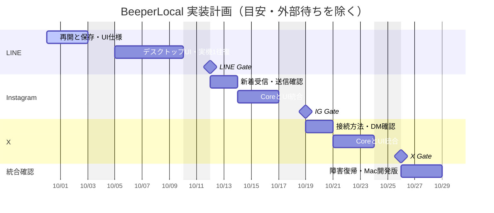

> 履歴: 2026-10-01の販売初版計画への改訂前の記録。現在の作業順・完了判定・委任許可として使わない。現行計画は[IMPLEMENTATION_PLAN](IMPLEMENTATION_PLAN.md)。

# 実装スケジュールとタイムライン

## 2026-10-01: Slack優先への方針修正

今回の最新ユーザー指示を優先する。対象は日本の顧客向けローカルMCP接続基盤。LINE・Instagram・Xを既存実装として保護し、次をSlack、その次の候補をDiscordとする。iMessage・WhatsAppは対象外。主担当だけで作業し、別チャットやサブエージェントへ委任しない。

Slackの過去PoC（User OAuth・履歴取得・暗号化保存・検索）の実績を維持し、不足していた送信・スレッド・定期取得・GUI/MCPを補った。認証方式は維持する。コード、ローカル試験、実アカウントE2E、商用配布を別の状態で判定する。実送信は承認された宛先と本文だけに限定する。

正確な会話範囲、着手前の分類、配布条件と残課題は[Slack実装記録](SLACK_IMPLEMENTATION.md)。公開チャンネル1会話で、本人送信の成功応答・履歴・保存・DB再オープン・検索・重複抑止と、本人のSlack側新着投稿の自動取得が成功。実DM・別の相手からの受信・スレッド返信等は未確認。商用配布適合性は未確認。Marketplaceのexport/backup・Automation platform向け制約への適合を確認するまで販売可能と表示しない。

旧計画は以下に履歴として残す。旧「別ChatRoom」等の記載を今回の委任許可として使わない。

## 2026-10-01: LINE安定化の追加結果

通常アプリ0.8.3で、LINEの一時通信障害が上限超過後に永久停止する経路を修正。実アプリの受信プロセスを7回連続終了しても、最後の中断から約61秒で自動復帰し、45会話と受信待機を確認した。Core325 / UI25成功。同じDeveloper IDで署名・更新互換性・配置hashも検証。下記の旧計画2の安定化を一部完了したが、実スリープ・実回線断・長時間と全履歴同期は残る。[LINEの修正・証拠・限界](LINE_RECEIVER_RECOVERY.md)。

## 2026-10-01: 変更前の計画（履歴）

ユーザーが以下の順序での実行を承認。今回は複数ChatRoomで進める明示依頼があるため、主チャットとX準備チャットで分担する。サブエージェントは使わず、この依頼を他案件の恒久設定変更とは扱わない。

| 順 | 作業 | 現状 / 完了条件 |
|---|---|---|
| 1 | Instagram統合版の実機1往復 | 完了。0.8.1で承認済み送信1回・相手側着信・返信、0.8.2で新着watch単独受信・再起動後の返信検索1件まで確認 |
| 2 | LINE / Instagramの安定化 | 進行中。LINE/IGの受信子プロセス終了からの自動復帰、IG停止中返信の起動時回収・表示/検索各1件を実測。LINE45会話・履歴・待機も確認。実スリープ・実回線断・長時間は未確認。直近LINE100/IG20件の回収を完全同期とは扱わない |
| 3 | X検証の引き継ぎと統合 | 別ChatRoomで既存PoCと証拠の整理を並行。認証・復号・履歴・新着・送信・再開が成立する契約に基づき、主チャットで通常アプリへ統合する |
| 4 | AI接続と使い勝手 | 利用者が選んだAIクライアントとLINE MCPを実接続。サービス横断検索、複数会話受信を実装・検証。IG/XのMCP権限は個別に実装し、LINEの許可を流用しない |
| 5 | 正式署名と配布 | 正式署名は別チャットで0.8.1から完了、0.8.2も同じ署名と更新互換性を検証済み。公証工程は未実施。別Mac検証は本人指定により後回し |

主チャットは本体ソース・通常BeeperLocal.app・LINE/IGの実機操作を担当する。X準備チャット「BeeperLocalのX連携を準備」（01a0f5a7-033b-7da2-a27e-214bcbcde8a7）は、`../x-integration-work/`だけを書き込み先とし、既存X資料の確認とadapter契約・不足条件を整理する。通常ソース、アプリ、Keychain、DBは変更しない。後続工程の準備は並行し、通常アプリへの統合は上の順序で進める。

0.8.0現在、LINEは45会話・既存履歴・名前／画像・待機を実測。Instagramは1会話・履歴9件・検索・待機を実測。Core280件、画面19件、IG adapter8件のローカル試験成功。正式な証拠は[0.8.0検証記録](desktop-0.8.0-verification.json)。以下の日付は当初案の履歴であり、現在の未実装一覧や確定納期ではない。

## 当初計画の記録（2026-09-30）

作成: 2026-09-30。実装順は **LINE → Instagram → 𝕏**。主担当1名で進める。

9/30更新: L2を前倒ししてBeeperLocal.app 0.5.1を配置。直近の既存ログはCore 198件・UI 8件成功。Mac再起動後にLINE接続・会話500件・実履歴・検索を確認し、承認済み送信1回のLINE受付、相手側着信のユーザー報告、アプリ再起動後の復元・検索まで確認した。返信受信と順番もユーザー報告で正常と確認し、アプリの基本送受信は完了。完全な増分同期は未完了。以下の日程は当初の計画で、追加MCP要件による見直しが必要。

9/30追加更新: 0.6.0を配置。上限付き再接続、権限付きローカルMCP、保存停止・account限定削除を実装し、Core 219/UI 11件を確認。独立SDK HTTPはfixture、実LINEの追加確認は読み取りのみ。MCPは初期無効で、実AI client設定は未実施。完全同期と長時間実運転のGateは引き続き残す。

## 基準と見積もり

対象はmacOS用のローカル統合DMクライアント。既存Python Core、Keychain、暗号化SQLite、検証済みline-cliを継続利用する。まず1対1のtext、会話一覧、履歴、受信、明示操作による送信、検索、再起動を扱う。SNS投稿タイムライン、Group、画像、スタンプ、reaction、既読同期、unsendはこの版に含めない。

以下は9/30開始、平日換算21作業日の計画案。祝日・本人の認証操作待ち・サービス側の接続問題・審査待ちを含まない。稼働時間や締切は未指定なので、確定納期や自動実行予約ではない。実機Gateの結果で後続日程を更新する。

| ID | 予定 | 作業日 | 成果物 | 完了条件・依存 |
|---|---|---:|---|---|
| L1 | 9/30–10/2 | 3 | LINEの起動時履歴回収、暗号化同期状態、増分再開の契約・実装、異常系テスト、UI仕様 | 保存と同期状態が同一transaction。再実行で重複せず、増分再開・更新反映を実機で確認 |
| L2 | 9/30に実装前倒し | 当初5 | Tauri 2 + React/TypeScript、狭いIPC、LINE会話・履歴・検索・送信画面を実装・ビルド済み | 実データ表示・送信・送信文の再起動→検索を実測。相手側着信と返信受信はユーザー報告で確認済み。基本送受信完了 |
| I1 | 10/12–10/13 | 2 | IG新着受信・送信の成立性確認、既存PoCを基にadapter契約確定 | LINE Gate後。履歴取得は既存証拠を再利用。受信イベント、送信結果、Keychain再開を個別確認 |
| I2 | 10/14–10/16 | 3 | IG connector、共通DB/UI統合、回帰テスト | 実DM1往復、再起動後検索、LINEとの混在・identity分離 |
| X1 | 10/19–10/20 | 2 | 𝕏の認証・DM履歴・送受信・利用条件の成立性確認 | IG Gate後。現在は実機証拠なし。利用可能な接続方法をこの工程で確定 |
| X2 | 10/21–10/23 | 3 | 𝕏 connectorと共通UI統合 | X1成立後のみ。実DM1往復、再起動後検索、3サービス混在 |
| R1 | 10/26–10/28 | 3 | 再接続・障害・性能確認、Mac開発版パッケージ | 各provider Gate後。外部署名配布・自動更新は別工程 |

## タイムライン

## 現在の証拠と着手範囲

- LINE: Core送受信→暗号化保存→検索の1往復はユーザー報告でCLOSED。会話catalog 500件は実機確認済み。GUI実装・Mac起動確認済み。0.5.1で接続・履歴・検索・送信・再起動後復元を実機確認。返信受信と順番はユーザー報告で正常確認済み。長時間運転は未確認。
- IG: 関連タスク「LINE接続検証継続」の9/30ユーザー報告で、1 threadの履歴3件、identity/timestamp各3件を確認。新着DMを送っても受信判定が反応しないとの報告あり。socket接続を受信成功と扱わない。Core統合・送信・資格情報の永続再開は未確認。
- 𝕏: この作業領域にconnectorも実機成功証拠もない。X1を省略して完了日を約束しない。
- Matrix/Slack: 既存保存・検索の実機成功証拠を維持し、回帰テスト対象とする。

本日着手するL1の範囲は、LINE daemonの開始前に直近履歴を取得し、メッセージ・会話・回収結果を一括暗号化保存すること。`sync-status line`で前回保存結果を確認できるようにする。

9/30実装結果: 上記の回収処理と状態確認を作業コピーへ追加済み。171 tests PASS（新規16、skipなし）、shell構文、offline demoを確認。新しい経路のlive確認とL1の増分再開Gateは未完了。検証ログ: [line-recovery-test-run.txt](line-recovery-test-run.txt)。

line-cli v0.4.0のローカル`messages --help`は直近1–100件の取得だけを公開している。したがって今回はbounded recoveryであり、完全な増分cursor同期とは呼ばない。Coreのcommitとline-cliのcursorは原子的ではない。停止中の大量受信やwatch開始直前の欠落を完全保証するには、次にack可能なイベント契約またはページングを持つadapterを検討する。GUIはこの制限を表示する。

## UI設計の判断

**L1は今回の回収処理だけでは完了しない。** adapterのincremental cursor/ack契約と再起動時の連続性は引き続き課題。再取得での同一ID更新は実装済み、削除を履歴不在から推定しない。ユーザーの追加指示を優先してGUIを前倒しし、履歴回収の上限と選択中の1会話だけが受信対象であることを画面に表示した。GUI前倒しをL1完了の証拠にしない。

既存の「共通モデル・ローカルDBを読む・provider SDKを画面から隔離する」方針を維持し、[UI_DESIGN.md](UI_DESIGN.md)の初期画面を実装した。fixtureによる画面操作確認と、実データを使う日常利用Gateを区別する。

## Gateと日程変更

各providerは「取得→保存→UI表示→送信1回→相手側受信→返信→ローカル受信→再起動→検索」が通って初めて日常利用Gateを閉じる。fixture成功はlive成功の代わりにしない。

IG/𝕏が外部要因で止まった場合は、理由・不足証拠・次の1操作を記録し、実装済み部分と未実装部分をUIに区別して表示する。予定を守るために架空データを実接続に見せない。順番の変更が必要な場合だけ相談する。
